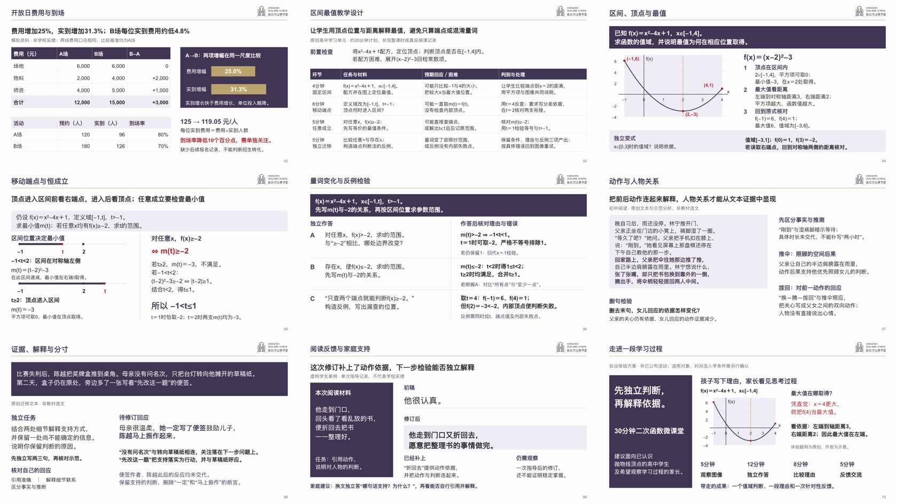

# 华朗学校汇报与教学 Skill

当前版本 **v10.0**。按华朗独立品牌制作校务汇报、教师教案、初高中及国际高中课件、家长沟通和招生材料。固定原始首尾、校徽和左题右徽金线，正文按对象和材料分别设计。

## V10：从失败稿重建规则和实际页面

V9.2介绍稿被用户否定：核心概论压成灰色小字，多数页仍是几组文字，场景说明代替了场景成果，短题含答不足以证明教学能力。原内容、表达场景及视觉通过结论已撤回。V10重写入口及关键参考，修改概论/口径工具入口，并用新的实际材料验证；没有把软件测试当成审美认证。

[11页可编辑样页](artifact-template-hualang-school/assets/scene-workbench-v10.pptx?raw=true) · [PDF留阅版](demo/scene-workbench-v10.pdf?raw=true) · [同材料前后对照](artifact-template-hualang-school/assets/comparison-v10.jpg) · [实页研究](artifact-template-hualang-school/references/layout-research-v10.md) · [本轮验证范围](tests/v10-validation.md)

| 对象 | 本版样页中实际能看到什么 |
|---|---|
| 校务管理 | 完整费用/人数、同尺度增幅、单位投入与判断边界 |
| 教师备课 | 20分钟原创学习单元计划，实际任务、预期困难、判别与处理相对应 |
| 高中数学 | 连续3页：区间图式、顶点/端点比较、移动端点、任意/存在、反例与诊断 |
| 初中阅读 | 连续2页：完整原创语境、动作证据、关系解释、新文本迁移与回应修订 |
| 家长反馈 | 同一原文、初修稿、已补上的解释、单次性质与家庭换文复核 |
| 招生体验 | 拟议微课堂的实际题例、理由对照、参与过程与适用条件；非已公布学校活动 |

数学和阅读是完整小学习单元，未宣称整课、实测用时或真实教学成效。样页中的数据、作答与计划分别标明模拟、虚构、原创和拟议属性。PPT保留原生文字、表格、数值图和关系图；部分教学对象按题目分步出现，应用放映兼容尚未核验。

## 这次改变了什么

- **概论恢复统领作用**：`lead`与兼容`summary`采用黑色、适当字重和主体以上层级；`contextLine`仅用于资料属性/口径。重要目标与操作不放灰字说明行。
- **按对象组织内容**：管理材料用于判断，教案用于实施，课件用于理解和独立作答，家长材料用于解释变化与支持，招生材料用于体验和选择。
- **先给具体对象空间**：函数图、数轴、原文、作品与比较系统承担主体；紫色面组织内容，避免开放排布退化成散字。
- **教学按学习单元验**：材料、知识联系、理由、条件/反例、独立任务和反馈形成对应。短介绍片段只证明其局部范围。
- **先看设计和使用，再查技术**：先审联排和最弱页，再查裁切、断行、数据和文件；独立审查不等于用户认可。

研究实际查看了设计网站原页，保留具体链接、观察与不适用部分；未将第三方模板预览图或收费PPT打包。模板中的占位文案和错误知识另作反例，不能沿用到教学材料。

[另有两页新材料独立试作](artifact-template-hualang-school/assets/independent-trial-v10.pptx?raw=true)：图书预算取舍、初中升温记录。执行者未看主样页，实际修复了反馈提前出现和关键理由过小；范围与过程见[验证记录](tests/v10-validation.md)。

## 开始使用

在支持本地技能的Codex环境中安装完整仓库：

> 从 https://github.com/2503668375-boop/hualang-ppt-skill 安装 artifact-template-hualang-school，保留完整模板与资源。

制作时附原件，说明读者、用途、形式、署名和日期。例如：

> 用华朗学校汇报技能，把附件费用和实到记录做成校务会议PPT，保留比较、差额、判断条件和可编辑对象。

教学再提供教材/课程体系、学科年级、课时和已知基础；家长与招生再提供作品、真实照片和现行条件。缺失信息只在影响内容或采用时追问。

[下载完整仓库ZIP](https://github.com/2503668375-boop/hualang-ppt-skill/archive/refs/heads/main.zip) · [技能入口](artifact-template-hualang-school/SKILL.md) · [制作API](artifact-template-hualang-school/references/production-api.md) · [历史变更](CHANGELOG.md)

## 历史与限制

[样张索引](artifact-template-hualang-school/references/sample-index.md)保留旧资产的版本及适用范围；旧样张存在不表示通过现行审查。V9.2及更早介绍不作为V10出品标准。原品牌底稿保持，不复制其他组织的品牌或身份。

本轮验证管理、高中数学、初中阅读、家长反馈和拟议体验的实际静态页面与指定揭示状态；未穷尽所有学段学科，未做PowerPoint应用内放映、现场投影或使用成效测量。
