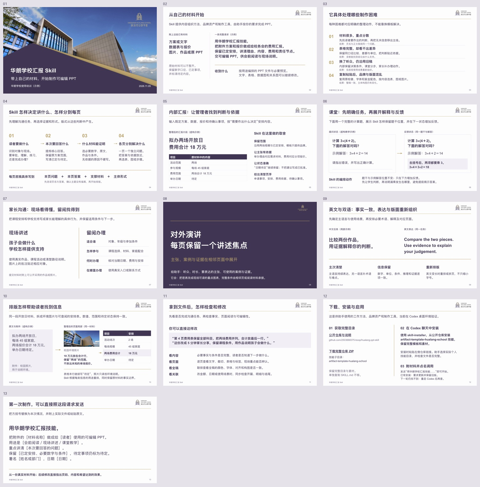
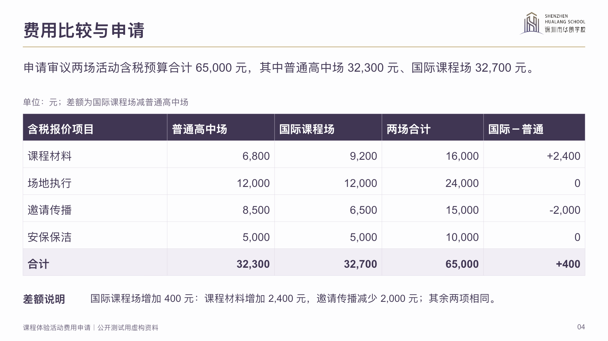
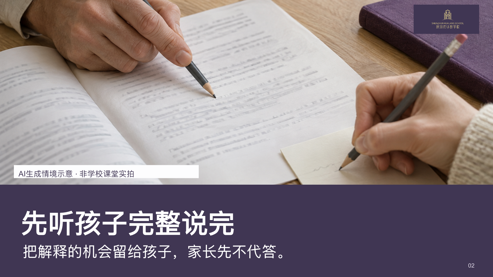

# 华朗学校汇报 Skill

当前版本 **v4.0**。输入内容、材料和使用要求，由助手组织主题、判断依据与页序，再按华朗品牌制作可编辑PPT。

## 开始使用

在具备本地技能与PPT制作能力的 Codex 桌面环境中，首次发送：

> 使用 skill-installer，从 https://github.com/2503668375-boop/hualang-ppt-skill 安装其中的 artifact-template-hualang-school 技能，保留完整模板和素材。

已安装时要求更新并保留旧版。下一轮附上材料，例如：

> 用华朗学校汇报技能，把附件方案和报价做成给校务会的费用汇报。保留两场已定安排，讲清理由、内容、费用和责任节点。只交可编辑PPT，署名与日期按附件。

[下载完整仓库 ZIP](https://github.com/2503668375-boop/hualang-ppt-skill/archive/refs/heads/main.zip) · [详细下载与启用说明](artifact-template-hualang-school/references/getting-started.md)

技能子目录是 `artifact-template-hualang-school`，需要完整目录。助手根据当前环境选择实际个人技能目录。首次安装方法依据[官方技能说明](https://learn.chatgpt.com/docs/build-skills)；本仓库未宣称上架插件商店。

## 制作时怎样工作

1. 从本次要求确定读者、用途、必答事项与必须保留的事实。
2. 先形成核心回答，将依据、比较、条件和动作分到各页。
3. 按内部汇报、课堂、家长沟通、演讲或培训用途选择版式。
4. 复用品牌和原生制作工具，完成文字、表格、图表与图像。
5. 先核对主题和要求，再审文案、实际排版与全稿视觉，修复后交付。

普通内容统一深紫文字、近白底及少量香槟金。内部保留比较与实施依据；课堂按学习任务组织；舞台演讲可用大字和主图。默认品牌底稿不含课程或业务案例，避免旧主题混进新材料。

## 使用介绍与实际制作检验

[13页使用介绍PPT](demo/hualang-skill-introduction.pptx?raw=true)

介绍围绕用法、具体痛点、思考结构、场景、排版及下载启动展开。具体实例只解释技能如何处理资料。

另外用独立虚构材料制作了[5页内部费用汇报](demo/internal-report.pptx?raw=true)和[4页对外演讲](demo/external-speech.pptx?raw=true)。三份输入与核验摘要见[实际制作检验](tests/README.md)。这些检验覆盖所列任务，未做Microsoft PowerPoint应用内放映或新设备安装测试。

 

## 规则与工具

- [技能入口](artifact-template-hualang-school/SKILL.md)
- [从任务到页面](artifact-template-hualang-school/references/workflow.md)
- [视觉、图片与表格](artifact-template-hualang-school/references/design.md)
- [课堂、家长与演讲](artifact-template-hualang-school/references/special-scenes.md)
- [原生制作工具](artifact-template-hualang-school/references/production-api.md)
- [任务与页面验收](artifact-template-hualang-school/references/review.md)
- [研究依据](artifact-template-hualang-school/references/research-basis.md)

所有公开测试数值、作答和安排均为虚构；生成图片清楚标示情境属性，不代表学校实绩。原始品牌模板保留。
