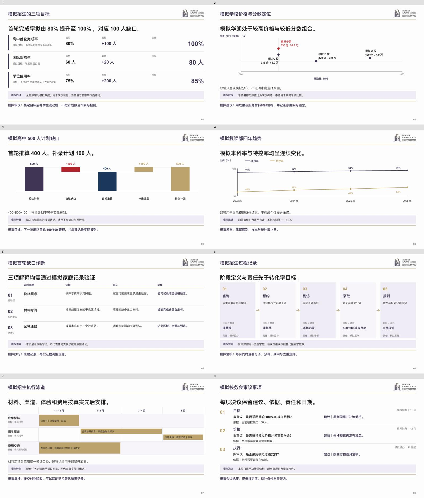

# 华朗学校汇报与教学 Skill

当前版本 **v12.0.1**。按华朗独立品牌制作可编辑的校务汇报、教案、课堂、练习、家长沟通、招生与公众演讲材料。V12 针对实际校董汇报的内容不足与版式重复，升级内容策划、原生图表、整稿节奏和派生指标检查。

## V12 的主要变化

- **逐页内容合同**：每页记录页面角色、读者问题与新增信息；开场、诊断、证据、方案、执行、决策和附录分别组织，删除后没有信息损失的页面必须合并或重写。
- **八类管理汇报主对象**：新增双轴定位、缺口桥、折线趋势、诊断、目标差额、转化过程、时间责任泳道和审议事项，全部保留原生可编辑文字与图形。
- **整稿节奏复核**：识别管理汇报中的版式集中、表格过多和连续同构，结合实际证据调整；必要续表、连续推理和同尺度比较可以保留。版式数量只用于发现问题，不能代替实页审美，也不要求课堂或演讲凑齐管理结构。
- **派生指标语义复核**：公式之外保留比较主体、基准、视角、期间和单位，自动复算差额、比例与价格影响，避免数值正确而对象或损益方向错误。
- **实际出品验证**：发布前用可公开模拟材料检查新管理版式，并以同一原创片段试作教师、学生、家长与公众材料。实际结果、修复及未测范围见下方验证记录。

[V12可编辑样张](artifact-template-hualang-school/assets/v12-report-layouts.pptx?raw=true) · [四场景独立试用](artifact-template-hualang-school/assets/v12-scene-trial.png) · [样张范围与文件](artifact-template-hualang-school/references/sample-index.md)

## V11 的主要变化

- **八类教育场景**：区分校务决策、教师教案与说课、学生课堂、练习复习、个体家长反馈、班级家长会、招生开放日和公众演讲，分别组织问题、证据和行动。
- **三档观看条件**：留阅、近距、远距分别设置文字层级、内容负载和图文重心。参数是起排参考，实际材料与可读性决定最终页面。
- **统一整稿入口**：助手从主题与附件组织页面规格，由 Python 构建器输出原生可编辑 PPTX；原有 JavaScript 底层通道继续支持定制精修。
- **六类表格**：比较、矩阵、日程、评价等按列类型与内容分配空间，长表按完整数据行续页，重复表头、保留口径及合计。
- **学习任务与反馈分开**：课堂及练习保留独立作答、答案反馈页和指定步骤的点击出现；未验证的应用播放不作承诺。

[三档可编辑样张](artifact-template-hualang-school/assets/python-3tiers.pptx?raw=true) · [页面规格](artifact-template-hualang-school/references/deck-spec.md) · [场景系统](artifact-template-hualang-school/references/scenario-system-v11.md) · [视觉语法](artifact-template-hualang-school/references/scene-visual-grammar.md) · [V12 验证](tests/v12-validation.md)

常规正文保留近白底、左题右徽与金线。远距实景主视觉允许按专项规范整页出血，使用金色校徽和清楚主张；固定原始封面、封尾及培养目标“华夏俊采，朗若星辰”继续保留。历史样张按[样张索引](artifact-template-hualang-school/references/sample-index.md)的版本和适用范围使用。

## 本次审查修订

V12.0.1 保留八种管理版式与派生指标复算，修正场景规则误用、审议事项容量、图形标注与来源上页等实际问题。学校内部原始出处和计算过程保留在底稿，观众页面呈现必要期间、单位、分母与判断依据。

[本轮验证记录](tests/v12-validation.md)记录实际出品和检查范围。示例的模拟、原创、拟议属性须保留；程序检查与 AI 审查不等于真实教学成效或用户审美认可。V11 的检查作为[历史记录](tests/v11-validation.md)保留。

## 开始使用

下载或安装完整目录，保留模板、图片、参考文件与工具：

> 从 https://github.com/2503668375-boop/hualang-ppt-skill 安装或更新 artifact-template-hualang-school，保留旧版备份及完整资源。

制作时附实际资料，直接说明读者、用途、形式、署名和日期，例如：

> 用华朗学校汇报技能，把附件费用和实到记录做成校务会议PPT，保留比较、差额、判断条件和可编辑对象。

教学补充教材或课程体系、学科年级、课时与已知基础；家长与招生提供作品、真实照片和当期条件。助手只追问影响内容正确性或正式采用的缺项。无需用户编写规格或代码。

[下载完整仓库 ZIP](https://github.com/2503668375-boop/hualang-ppt-skill/archive/refs/heads/main.zip) · [技能入口](artifact-template-hualang-school/SKILL.md) · [上手说明](artifact-template-hualang-school/references/getting-started.md) · [版本记录](CHANGELOG.md)

## 制作与验证边界

Python 通道依赖 `python-pptx`、`Pillow`，原有 JavaScript 通道依赖支持的原生制作运行库。八类场景示例及一组长表位于 `artifact-template-hualang-school/assets/examples/`，入口见[页面规格](artifact-template-hualang-school/references/deck-spec.md)；特殊图形和复杂学科对象使用底层通道精修。

最终 PPTX 应由实际演示引擎打开后导出并检查。结构镜像只辅助核对内容与坐标，不能证明最终字形、换行和播放效果。本次未完成 Microsoft PowerPoint 应用内放映、现场投影或真实教学成效验证，也未穷尽所有学段学科。
