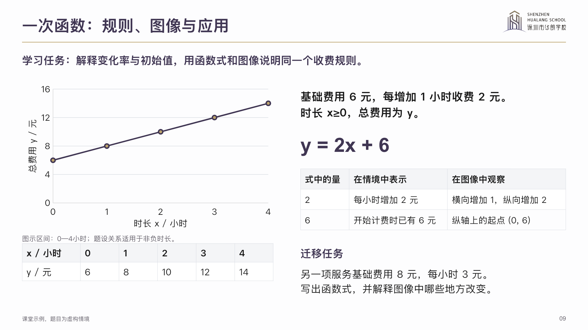

# 华朗学校通用汇报

面向华朗学校的内部管理、课堂教学、家长沟通与对外展示，制作可编辑 PPT，并按需要提供配套一页纸。当前版本 **v2.1**。

先确定读者、任务和内容，再决定每页怎么写、怎么排。内部汇报保留完整论证、信息密度和审查要求；教育场景通过图表、图解、流程、路径和任务组件帮助理解。英文与双语版本分别组织语言和版面。

## 看一次实际应用介绍

[](demo/hualang-skill-introduction.pptx?raw=true)

[下载管理层介绍 PPT](demo/hualang-skill-introduction.pptx?raw=true)

这份 18 页案例模拟华朗管理层介绍本技能，说明怎么使用、解决哪些常见问题、不同场景如何改变排版，并以实际页面展示图表的作用和检查方法。它是一份完整介绍，不是组件目录。教学题例、经营数据和安排中的模拟内容会明确标示，不代表学校实绩或已批准计划。

<a href="demo/internal.png"></a> <a href="demo/education.png"></a>

## 按用途选择写法

| 用途 | 内容与排版重点 |
| --- | --- |
| 学校管理层、校务会、经营及专项汇报 | 短业务题名、正式概论、充分依据；同页核对目标、实际、差额、原因和行动，保留费用、条件、责任和时点。 |
| 学生课堂、复习和复读备考 | 概念图解、例题批注、错因对照、变式练习与评价；保留题干、单位、条件和推理。 |
| 家长沟通、招生说明 | 平行课程路径、同维度比较、学习反馈与家校行动；把适用条件和家庭需要配合的事项讲清楚。 |
| 对外演讲、教学交流 | 清楚主线、案例、图文证据与数据可视化；图表支持主张，说明适用范围。 |
| 英文及双语 | 核对术语和事实，重新断行排版；提供必要的术语、图解和句式支架。 |

普通内容底色接近白色（`#FDFDFE`），辅助分区用中性浅灰。保留华朗校徽及紫金识别，默认左侧题名、右侧校徽；主体构图按内容变化。内部正文黑字、重点红色，教育展示按任务使用紫色强调。

图表减少的是重复散文，不能删掉事实和推理。数值图检查变量、坐标和单位；流程与路径检查真实关系；家长材料保留条件；中英文版本保持数据和结论一致。无实际测量时，不宣称固定的效率提升或学习效果。

## 下载与安装

复制这句话，发给 **Codex 或 WorkBuddy**：

```text
请从 https://github.com/2503668375-boop/hualang-ppt-skill/tree/main/artifact-template-hualang-school 下载完整的「华朗学校通用汇报」技能，安装到当前工具的个人技能目录，并核对模板与参考文件完整。
```

也可[下载整个仓库 ZIP](https://github.com/2503668375-boop/hualang-ppt-skill/archive/refs/heads/main.zip)，按所用工具的安装方式，安装其中的 `artifact-template-hualang-school` 文件夹。

附上本次材料，说明受众和用途即可，例如：

> 用华朗模板，把附件做成校务会月度经营汇报，展开招生差额、预算与实际、原因和责任节点。

> 用华朗模板，做一套高一数学复习课件，保留例题推导，增加错因对照与变式练习。

> 用华朗模板，做一份家长课程说明，把选择路径、适用条件和家校配合可视化。

也可以调用 `$artifact-template-hualang-school`。已有要求和资料直接沿用，只补问影响结果的缺项。

## 技能资源

- [技能入口](artifact-template-hualang-school/SKILL.md)：按内部汇报与教育场景选择流程。
- [华朗汇报方法](artifact-template-hualang-school/references/reporting-method.md)：起稿、论证、排版与三遍审查的方法。
- [视觉与组件规范](artifact-template-hualang-school/references/design.md)：近白背景、华朗品牌、字体和内容构图。
- [特殊图表验收](artifact-template-hualang-school/references/review.md#特殊场景图表是否达到要求)：按图表作用检查是否帮助理解，是否存在误导。
- [后台制作参考](artifact-template-hualang-school/assets/reference.pptx?raw=true)与[原始品牌模板](artifact-template-hualang-school/assets/source-original.pptx?raw=true)：用于制作时取用，不代替本次应用介绍。
- [Word 一页纸母版](artifact-template-hualang-school/assets/one-page-report.docx?raw=true)：仅在需要独立简报或配套一页纸时使用。

PPT 使用 PingFang SC 与 Arial。更换电脑或字体后需复查换行、图表和表格。只有实际在 PowerPoint 中打开并查看后，才可声称完成该软件验证。

## 持续维护

优化在本仓库持续更新，记录在 [CHANGELOG](CHANGELOG.md)。修改同时核对规范、模板、案例和个人安装版；规则与实际页面应一致，文案、信息密度、图表含义和版面均需检查。

```bash
python3 scripts/validate_package.py --expected-slides 15
```

该命令检查后台参考资产的文件、相对引用和原生对象结构。它不能代替对介绍案例、特殊图表及实际阅读效果的审查。

校徽、校名及校园素材不因本仓库公开而授予商标或其他使用权；本仓库不代表学校的正式对外发布。
