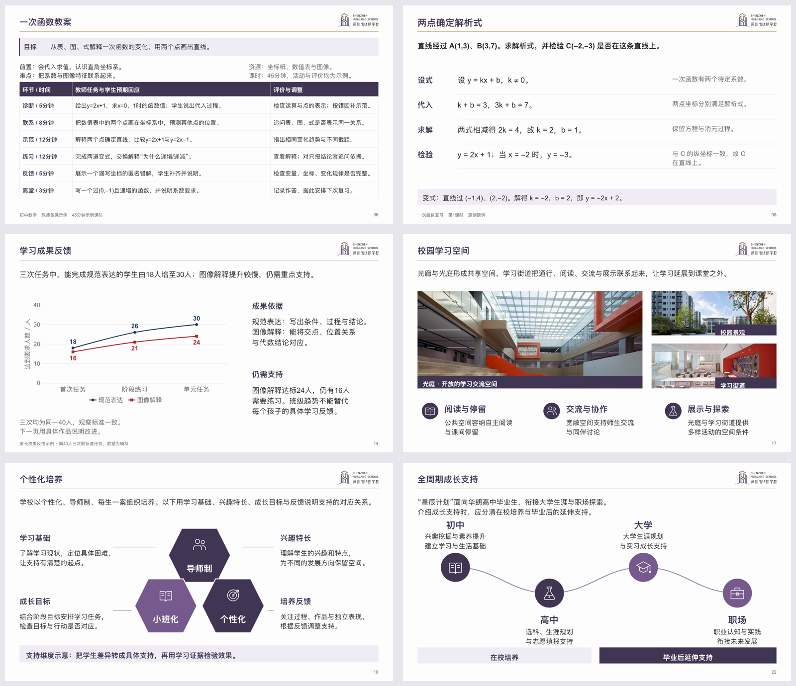

# 华朗学校汇报与教学 Skill

当前版本 **v7.0**。用于华朗内部汇报、分学科教案与课件、家长成果反馈、招生说明和对外交流。各场景沿用既定华朗正文模板，按实际材料安排密度与组件。

## 本版改动

- **保留原模板框架**：左标题、右校徽、金色分隔线和近白正文底保持一致，版式变化发生在正文区。
- **提高有效内容密度**：同页保留材料、解释、比较和条件。教学短题成组、完整解答尽量同屏；不靠大字和空白增加页数。
- **区分家长与招生任务**：家长成果保留同口径数据、作品改进与家校支持；招生活动的体验、课程选择和办理信息分别组织。
- **华朗紫组件组合**：根据用户指定研究深大公开模板的主题色方法，新增9类原生线性图标、编号、图标说明、图片色标和横向要点带，与蜂窝关系、比较矩阵、主次照片、指标和曲线路径配合。
- **连续长稿验证**：新增32页《一次函数单元复习》，含30页正文，三课时计划各45分钟。检查相邻重复、四页循环、完整题解和揭示状态；实际课时仍须按学情调整。
- **封底完整收束**：保留原底图，加入“华夏俊采，朗若星辰”及场合结束语。该句为培养目标；校训为“春华秋实，弘朗日新”。

## 下载与预览

- [26页技能介绍与场景示范](demo/hualang-skill-introduction.pptx?raw=true)
- [32页连续教学实测](demo/linear-functions-32.pptx?raw=true)
- [完整仓库ZIP](https://github.com/2503668375-boop/hualang-ppt-skill/archive/refs/heads/main.zip)

介绍稿第6页为教师教案，第7—11页为课堂与学科示例，第12—13页为内部汇报，第14—16页为家长成果反馈，第17—22页为校园、培养、招生与交流案例，第23—25页说明组件和使用，第26页为固定封底。公开业务数据与原创题例均标明性质；实际活动、照片和校情附必要出处。

## 使用

首次安装时发送：

> 从 https://github.com/2503668375-boop/hualang-ppt-skill 安装 artifact-template-hualang-school，保留完整模板和素材。

制作时附上实际材料，说明用途、听众、学段学科、课时或汇报目标，以及署名和日期。例如：

> 用华朗学校汇报技能，把附件做成家长会成果反馈。保留同口径变化、匿名作品对照、原因和支持安排，沿用华朗正文模板，相关内容尽量同页。

> 用华朗学校汇报技能制作初中一次函数复习课。完整题干、推理和变式尽量同屏，答案按关键步骤揭示，另给教师的活动与评价安排。

## 规则与验证

[技能入口](artifact-template-hualang-school/SKILL.md) · [单页容量](artifact-template-hualang-school/references/teaching-design.md) · [长篇编排](artifact-template-hualang-school/references/longform-layout.md) · [家长与招生](artifact-template-hualang-school/references/parent-admissions.md) · [深大样例研究与华朗应用](artifact-template-hualang-school/references/szu-reference.md) · [制作API](artifact-template-hualang-school/references/production-api.md) · [本轮验证](tests/v7-validation.md)

已检查保存后的文件、页面、品牌框架、相邻构图和揭示状态；未完成 Microsoft PowerPoint 应用内放映或真实教室投影测试。示例可用于理解方法，具体课程、活动、招生条件与数据须按实际任务更新。历史版本记录保留，当前以v7.0规则及上述两份案例为准。
