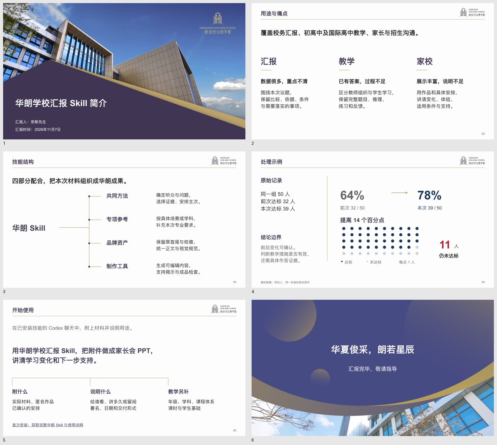

# 华朗学校汇报与教学 Skill

当前版本 **v8.4**。把学校已有的数据、教材、题目、作品和方案，整理成适合本次使用的汇报、教案、课件与家校沟通材料。保留华朗原校徽、固定首尾，以及左题右徽、金线和近白底的正文框架。

## 简短了解

[6页可编辑介绍](demo/brief-introduction.pptx?raw=true) · [PDF预览](demo/brief-introduction.pdf?raw=true)

介绍由奈斯先生署名，依次说明用途与痛点、技能组成、一次具体处理和开始方式。唯一完整示例集中在一页，数据明确为模拟；点阵表示本次人数，不代表个体转变。

技能由四部分组成：共同方法负责内容判断，专项参考补充场景和学科要求，品牌资产保持学校身份，制作工具形成可编辑对象并支持检查。主要用于校务与内部汇报、初中/高中/国际高中教案和课件、家长成果反馈、招生说明与对外交流。

## 开始使用

首次安装时，在具备本地技能能力的 Codex 环境发送：

> 从 https://github.com/2503668375-boop/hualang-ppt-skill 安装 artifact-template-hualang-school，保留完整模板与素材。

制作时附实际材料，说明给谁看、解决什么问题，以及署名、日期和交付形式。例如：

> 用华朗学校汇报技能，把附件做成家长会PPT，重点说明学习变化和下一步支持。保留匿名作品、比较条件和已确认安排。

教学任务再补充年级、学科、教材/课程体系、课时与学生基础。由助手核对当前环境与所需依赖；安装成功不代表成品已通过内容和视觉检查。详细方式见[下载与开始使用](artifact-template-hualang-school/references/getting-started.md)。

[下载完整仓库 ZIP](https://github.com/2503668375-boop/hualang-ppt-skill/archive/refs/heads/main.zip) · [发布版本](https://github.com/2503668375-boop/hualang-ppt-skill/releases)

## v8.4 更新

- **先去重，再分页**：每页新增独立答案、依据或操作。合并无增量的成果预告和完整示例；保留管理对照、稳定题干及教学递进需要的复现。
- **主体承担信息**：实际成果、原文批注、关系图、数值图和学科对象按任务选用。换色、删底框、换组件名不足以证明版式变化；文字概览可用，但不覆盖全稿。
- **按用途控制详略**：修复制作参考把内部报告深化要求泛化到介绍的残留冲突。内部留阅、阅读型家长材料和教学深度继续保留，短介绍不搬运整套制作规则。
- **更新成品与使用入口**：介绍由8页合并为6页，重做正文主体；首页改为用途、结构、样例和开始方式。修正实际换行和页脚间距，提供可点击的获取入口。
- **增加微观精修**：同类文字、组内外间距、字形与基线、线条及图注保持秩序；收拢字号与色彩强调，删除多余编号、巨型引号和无意义线尾。用本次介绍实际调整并复看，具体方法集中在[微观精修](artifact-template-hualang-school/references/design.md#微观精修)。

本轮详细范围、已发现问题、最终检查与限制见 [V8.4验证](tests/v8.4-validation.md)。历史验证记录保持原范围，不重新标作本轮全部通过。

## 其他应用示例

以下示例用于观察具体对象和方法，按当前任务重新组织，不能直接把旧主题当成新材料。

- [10页管理汇报内容深化示例](demo/report-depth-example.pptx?raw=true)：模拟材料的比较、解释与实施条件，保留必要原生表格和趋势图。
- [V8.1版式示例](demo/report-layout-example.pptx?raw=true)：12页历史主体构图示例。
- [16页应用示例](demo/hualang-skill-introduction.pptx?raw=true)：管理、教师备课、物理、文本研读、国际经济学、家长与校园说明。
- [32页二次函数连续课件](demo/quadratic-functions-32.pptx?raw=true) · [末态预览](demo/quadratic-overview.jpg) · [教师使用说明](demo/quadratic-teacher-guide.md)

题例、数据与安排保留原创、模拟或计划属性，不冒充学校实绩、官方真题或官方评分。静态预览不代表动画放映或真实授课效果。

## 规则与验证

[技能入口](artifact-template-hualang-school/SKILL.md) · [内容策划](artifact-template-hualang-school/references/workflow.md) · [构图](artifact-template-hualang-school/references/composition.md) · [组件选用](artifact-template-hualang-school/references/component-index.md) · [四项验收](artifact-template-hualang-school/references/review.md) · [V8.4验证](tests/v8.4-validation.md) · [V8.3验证](tests/v8.3-validation.md) · [教学设计](artifact-template-hualang-school/references/teaching-design.md) · [教学深度](artifact-template-hualang-school/references/teaching-depth.md) · [内容正确性](artifact-template-hualang-school/references/content-accuracy.md) · [制作API](artifact-template-hualang-school/references/production-api.md)

本轮检查最终保存文件、静态实页、内容去重与公开包完整性。未做 Microsoft PowerPoint 应用内放映、真实投影或教学效果验证；软件响应和检查程序不能认证审美。
