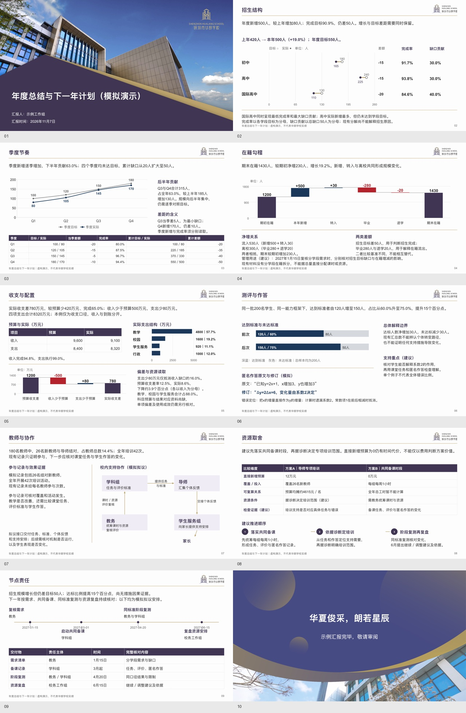

# 华朗学校汇报与教学 Skill

当前版本 **v8.2**。用于华朗内部汇报、分学科教案与课件、家长成果反馈、招生说明和对外交流。保留左标题、右校徽、金色分隔线、近白底及原始固定首尾。

## 本版改动

- **内容先展开再分页**：沿已有材料补比较、构成、过程/案例、解释、取舍与落实；主动复算有意义的关系，保留推断与建议的条件，缺少原因资料不补造。
- **一页形成完整分析**：图表和近邻段落共同承担内容。少量节点的小图不默认铺满；结果与解释、日期与责任等相关短页，在允许范围和可读字号下优先合并。用户指定页数优先遵守。
- **深化和排版一起验收**：逐页试读新增了什么证据与解释，检查结果的含义、建议的机制与代价、安排的完成物与检查；不靠重复数字、空话、缩字或增页增加信息。

继续保留V8.1的主体构图与工具：

- **主体构图先于组件**：从读者要比较、追踪、观察、选择还是查数起稿。主证据可以跨栏，说明靠近实际对象；补充趋势、差异、贡献、证据、关系、方案、节点与完整字段的整页选择及旧稿转换方法。卡片只用于适合的独立并列项。
- **开放式制作入口**：新增开放数字、同轴点比较、按真实日期定位的时间线和就近引注。正文完整工作区可以自由编排，历史接口继续兼容；不循环同一方块网格制作全稿。
- **看真实骨架**：无清单也能检查最终PPTX，识别近似、镜像、组合对象、等宽面板与连续/隔页复用。标签、换色、去边框和卡片数量变化不能代替实页判断；机器提示须结合内容复核，必要比较可保持同构。

继续保留V8的教学与内容要求：

- **保留密度与教学深度**：完整对象、解释依据、方法边界、反例、独立迁移和诊断反馈相互对应。教师教案与学生课件分别设计，不靠缩字、堆难题或增页制造深度。
- **内容正确性两关**：起稿检查输入，交付前再审最终成品。用户提供的案例、百科、题解、数据与引用也可能有错；发现错误、争议或关键未核实项，主动给出位置、依据、影响与建议。重要问题未解不能称可直接授课或正式采用。
- **动画辅助理解**：按实际模型、工具与文件能力，在有理解收益处主动使用图形、参数、过程和证据动画。本版课件使用原生点击出现，逐步建立轴位置、交点、条件、曲线与最优点，不宣称平滑变形。
- **完整思考链**：从材料、事实、判断、条件到读者动作逐项追溯；合并历史补丁，避免把某次页数、版式变化或脚本通过当作质量证明。

## 下载与预览

- [10页管理汇报内容深化示例](demo/report-depth-example.pptx?raw=true)：原始数字、案例与安排不变，展开可复算比较、解释和实施条件；正文由10页整合为8页，保留4张必要原生表与1张季度趋势图。全部为模拟，未添加学校实绩或未提供的原因。

- [V8.1版式示例](demo/report-layout-example.pptx?raw=true)：保留12页原版，供查看上一版的主体构图与本轮深化前的内容。

- [16页应用示例](demo/hualang-skill-introduction.pptx?raw=true)：管理、教师备课、物理、文本研读、国际经济学、家长与校园说明。只保留1张必要查数表，6页含分步揭示。
- [32页二次函数连续课件](demo/quadratic-functions-32.pptx?raw=true)：30页正文，仅1张函数数值表，30页有原生点击出现，共77步。
- [二次函数末态预览](demo/quadratic-overview.jpg) · [教师使用说明](demo/quadratic-teacher-guide.md)
- [完整仓库ZIP](https://github.com/2503668375-boop/hualang-ppt-skill/archive/refs/heads/main.zip)

题例、数据与安排明确标示为原创、模拟或计划，不冒充本校实绩、官方真题或官方评分。三课时各45分钟是备课计划，未经实授。预览展示完整末态，不是动画播放录像。历史一次函数示例仍可查阅，但现行长篇示例以二次函数为准。

## 开始使用

首次安装时发送：

> 从 https://github.com/2503668375-boop/hualang-ppt-skill 安装 artifact-template-hualang-school，保留完整模板与素材。

制作时附实际材料，说明用途、听众、学段学科、课时或汇报目标，以及已确认署名和日期。例如：

> 用华朗学校汇报技能，把附件做成家长成果反馈。保留同口径变化、匿名作品对照、解释与支持，用小组件组织，只在必要查数时使用表格。交付前核对材料中的知识、案例和数字，发现问题提醒并给建议。

> 用华朗学校汇报技能，把附件制作成年度管理报告。先按每页的读者动作选择主证据与主体构图，保留完整比较、解释与条件。查看连续四页及整稿，修正反复的方块拼装；不要靠换色、增加版型名称或删内容制造变化。

> 用华朗学校汇报技能，把附件制作成管理层留阅报告。先展开有依据的比较、分析、取舍与落实，再定页数和构图。每页保留完整阅读关系，简单图表旁补足解释；相关短页按需要合并。不能补造原因、数字、责任或承诺。

> 用华朗学校汇报技能制作高中二次函数复习课。完整题干、推理、比较反例与迁移尽量同屏，重点图形和条件按教学节奏揭示，另给教师活动与诊断反馈安排。资料或题解有错时先指出并建议修正。

## 规则与验证

[技能入口](artifact-template-hualang-school/SKILL.md) · [内容深化与容量](artifact-template-hualang-school/references/content-depth.md) · [V8.2验证](tests/v8.2-validation.md) · [内容与版式](artifact-template-hualang-school/references/report-layouts.md) · [构图修订说明](docs/v8.1-layout-review.md) · [教学设计](artifact-template-hualang-school/references/teaching-design.md) · [教学深度](artifact-template-hualang-school/references/teaching-depth.md) · [内容正确性](artifact-template-hualang-school/references/content-accuracy.md) · [教学动画](artifact-template-hualang-school/references/teaching-animation.md) · [制作API](artifact-template-hualang-school/references/production-api.md)

已完成独立内容复算、最终文件回读、逐页及联排、关键揭示状态、原生对象与工具行为验证。未完成Microsoft PowerPoint实际放映、真实教室投影或教学效果验证；不能由本轮数学与局部学科示例推定所有教材、学科或考试局均已验证。公开项目图不自动证明当前校园状态或课程安排，来源与属性按实际任务核实。
