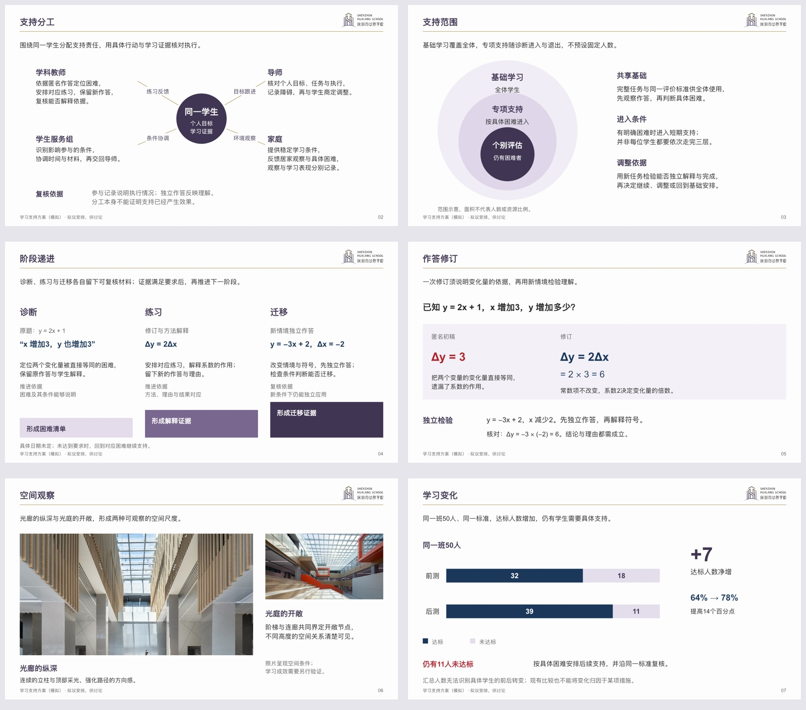
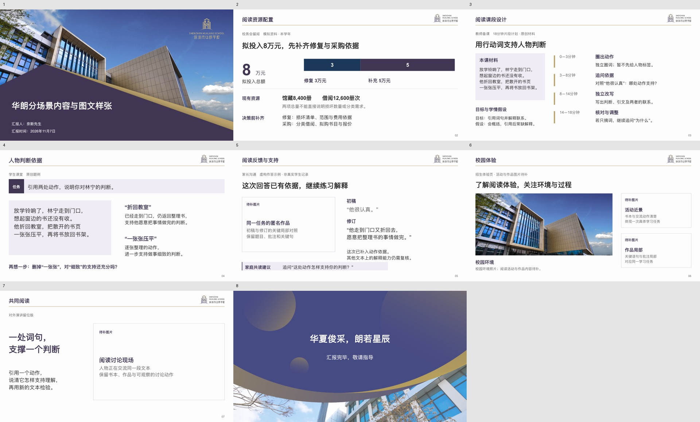
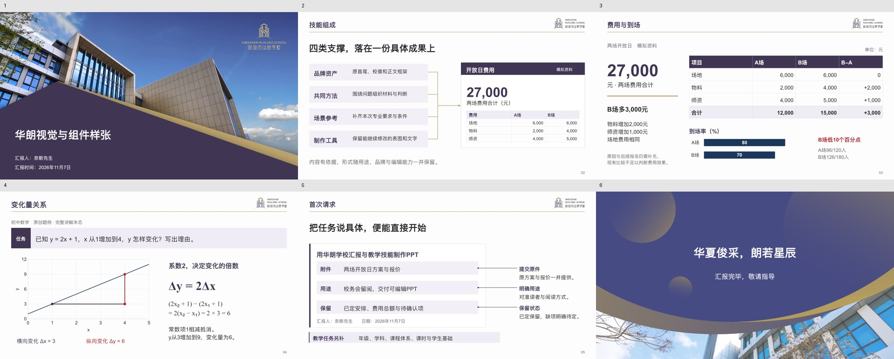

# 华朗学校汇报与教学 Skill

当前版本 **v9.1**。把学校已有的数据、教材、题目、作品和方案，整理成适合本次使用的汇报、教案、课件与家校沟通材料。保留华朗原校徽、固定首尾，以及左题右徽、金线和近白底的正文框架。

## 本版构图应用

[可编辑样张](artifact-template-hualang-school/assets/layout-atlas.pptx?raw=true) · [关系、密度与主题统一](artifact-template-hualang-school/references/layout-atlas.md) · [排版研究与吸收](artifact-template-hualang-school/references/layout-research.md) · [交给其他 AI 的试用任务](artifact-template-hualang-school/references/other-ai-trial.md)

六种正文分别呈现中心支撑、范围包含、阶段递进、作答对照、校园图文和数据解读。机制、课程安排与学习数据均为原创模拟或拟议，校园照片来自既有品牌素材；不代表学校实绩。样张用于观察构图方法，不要求新稿按顺序套用。

## V9.1 对象、场景与图文设计

[可编辑留位版样张](artifact-template-hualang-school/assets/scene-design-v9.1.pptx?raw=true) · [场景设计](artifact-template-hualang-school/references/scene-layouts.md) · [图片与留位](artifact-template-hualang-school/references/image-planning.md) · [验证范围](tests/v9.1-validation.md)

延续用户认可改善的V9视觉方向，继续将不同对象的内容和页面分别设计：管理关注判断与取舍，备课关注活动及评价，课堂关注学习对象与推理，家长关注作品变化与支持，招生和演讲按体验、选择或讲述节奏组织。丰富度来自必要证据、解释、过程与条件，不用同一套分栏换标题。

新增原生可编辑图片留位，记录具体主体、用途和素材要求，可按相同位置填图。样张正文有1张已有校园品牌图片和4处明确待补图位；它是用户允许的留位版，未将缺图当作已有证据或宣称可直接正式对外发布。配图后需同步核对相关文字与判断。

## V9 视觉与组件整改

[可编辑样张](artifact-template-hualang-school/assets/visual-refinement-v9.pptx?raw=true) · [实际改动与验证边界](tests/v9-validation.md)

本版针对用户否定的V8.6介绍稿重新整改。撤回那份9页稿的视觉通过结论；旧例子仅保留历史参考，不能据此前检查证明美感。

- **视觉决定先于摆组件**：选值得强调的数值、作品或材料，明确主次、比例与阅读距离；正文可使用大尺度实际信息，避免最大色面突出泛词。
- **修改真实组件实现**：任务带统一标签与正文垂直对齐；方法条默认收至720px并允许标签宽、余量和行高；批注有明确端口与左右对齐；中心连接默认贴边。
- **以实页对照验证**：组成、费用、数学和请求四类样张分别检验成果焦点、数字主次、图式关系及精确批注。中途发现的单位缺失、浮空箭头、单位距离和底部余量问题已修正。
- **审查不再只排除硬错**：同材料前后对照、长短标签/不同负载/左右批注变体，分别记录改动及限制；软件测试和AI审查不能替代用户认可。

样张保留原品牌首尾、近白底和原生对象，使用模拟数据及原创题例。它们是本轮整改证据，用户已反馈V9排版明显改善；新材料仍须实际检查，不保证所有输入自动得到同样效果。

## v8.6 更新

- **从实际成稿修正规则**：增加[介绍与培训](artifact-template-hualang-school/references/skill-intro.md)，区分初次了解、使用培训和专业维护；用可辨认成品证明能力，合并无信息增量的重复页，内部规范留在技能包。
- **让关系与组件可检查**：逐页写出具体关系、主对象、主要组件及新增作用，补充任务带、方法条、指标、点比较、里程碑、批注、辐射、旗标、聚焦面板与阶梯的语义；遮页标题复核主体，按本次指定上限清点重复，不把局部配额强加给所有课堂。
- **清理跨场景冲突**：备课与课堂分别组织，比较保留可比尺度而不强制等分；报告入口明确开放正文，阅读同屏与讲述/揭示单元分别判断。
- **补上跨工具实现依据**：统一画布、EMU/逻辑px/pt换算、字号起点、品牌几何和原生对象要求；模拟标识贴近主体。现有运行库可用才调用辅助库，不要求从公共npm安装。
- **区分实际渲染与结构镜像**：验收记录声明预览方式，镜像、未知及未声明来源不能进入待签收；程序只核声明与证据，不自动识破虚假声明、不认证美观。
- **修正标题误拦并索引样张**：“从……开始”转人工复核，保留口播问句规则；[样张索引](artifact-template-hualang-school/references/sample-index.md)列出实际页数、选页、用途与示例性质。

本轮范围与验证见[V8.6记录](tests/v8.6-validation.md)。品牌原资产及旧示例保留；本次审查用户提供的介绍稿，没有将其重制或标为已通过。

## v8.5 更新

- **增加关系驱动的构图库**：说明辐射、包含、分流、汇聚、递进、循环、比较及图文组合的适用条件、负载与误用；吸收 Microsoft、Duarte、TED、Slidesgo 的可观察实例和本机相关技能方法。
- **补上可用的中心组件**：新增可编辑 `hubSpoke`，外围区域按材料分配，保留关系词与完整说明，可省连接线，不自动画外围闭环；旧入口保留兼容。
- **密度和主题同时检查**：固定品牌、字体角色、色彩与间距，主体随问题改变。去框后重复横线、线性分行或圆阵同样复核；不设组件数或版型配额。
- **继续精修实际部件**：收紧中心与外围比例，连接落到明确锚点，阶梯让位给具体证据；作答共享基线，照片图注移出证据区域，数据只保留一个主要强调入口。相应方法进入微观精修，不能只凭版式种类判定完成。
- **提供完整试用入口**：完整技能包内含实际样张、预览、制作参考和独立任务；其他 AI 可使用自己的原生PPT工具，不能只读取一个入口文档便宣称安装或制作完成。

实际检查与边界见 [V8.5验证](tests/v8.5-validation.md)。既有介绍和学科示例保留其原版本范围。

## 既有六页介绍

[6页可编辑介绍](demo/brief-introduction.pptx?raw=true) · [PDF预览](demo/brief-introduction.pdf?raw=true)

介绍由奈斯先生署名，依次说明用途与痛点、技能组成、一次具体处理和开始方式。唯一完整示例集中在一页，数据明确为模拟；点阵表示本次人数，不代表个体转变。

技能由四部分组成：共同方法负责内容判断，专项参考补充场景和学科要求，品牌资产保持学校身份，制作工具形成可编辑对象并支持检查。主要用于校务与内部汇报、初中/高中/国际高中教案和课件、家长成果反馈、招生说明与对外交流。

## 开始使用

首次安装时，在具备本地技能能力的 Codex 环境发送：

> 从 https://github.com/2503668375-boop/hualang-ppt-skill 安装 artifact-template-hualang-school，保留完整模板与素材。

制作时附实际材料，说明给谁看、解决什么问题，以及署名、日期和交付形式。例如：

> 用华朗学校汇报技能，把附件做成家长会PPT，重点说明学习变化和下一步支持。保留匿名作品、比较条件和已确认安排。

教学任务再补充年级、学科、教材/课程体系、课时与学生基础。由助手核对当前环境与所需依赖；安装成功不代表成品已通过内容和视觉检查。详细方式见[下载与开始使用](artifact-template-hualang-school/references/getting-started.md)。

[下载完整仓库 ZIP](https://github.com/2503668375-boop/hualang-ppt-skill/archive/refs/heads/main.zip) · [发布版本](https://github.com/2503668375-boop/hualang-ppt-skill/releases)

## v8.4 更新

- **先去重，再分页**：每页新增独立答案、依据或操作。合并无增量的成果预告和完整示例；保留管理对照、稳定题干及教学递进需要的复现。
- **主体承担信息**：实际成果、原文批注、关系图、数值图和学科对象按任务选用。换色、删底框、换组件名不足以证明版式变化；文字概览可用，但不覆盖全稿。
- **按用途控制详略**：修复制作参考把内部报告深化要求泛化到介绍的残留冲突。内部留阅、阅读型家长材料和教学深度继续保留，短介绍不搬运整套制作规则。
- **更新成品与使用入口**：介绍由8页合并为6页，重做正文主体；首页改为用途、结构、样例和开始方式。修正实际换行和页脚间距，提供可点击的获取入口。
- **增加微观精修**：同类文字、组内外间距、字形与基线、线条及图注保持秩序；收拢字号与色彩强调，删除多余编号、巨型引号和无意义线尾。用本次介绍实际调整并复看，具体方法集中在[微观精修](artifact-template-hualang-school/references/design.md#微观精修)。

本轮详细范围、已发现问题、最终检查与限制见 [V8.4验证](tests/v8.4-validation.md)。历史验证记录保持原范围，不重新标作本轮全部通过。

## 其他应用示例

以下示例用于观察具体对象和方法，按当前任务重新组织，不能直接把旧主题当成新材料。

- [10页管理汇报内容深化示例](demo/report-depth-example.pptx?raw=true)：模拟材料的比较、解释与实施条件，保留必要原生表格和趋势图。
- [V8.1版式示例](demo/report-layout-example.pptx?raw=true)：12页历史主体构图示例。
- [16页应用示例](demo/hualang-skill-introduction.pptx?raw=true)：管理、教师备课、物理、文本研读、国际经济学、家长与校园说明。
- [32页二次函数连续课件](demo/quadratic-functions-32.pptx?raw=true) · [末态预览](demo/quadratic-overview.jpg) · [教师使用说明](demo/quadratic-teacher-guide.md)

题例、数据与安排保留原创、模拟或计划属性，不冒充学校实绩、官方真题或官方评分。静态预览不代表动画放映或真实授课效果。

## 规则与验证

[技能入口](artifact-template-hualang-school/SKILL.md) · [内容策划](artifact-template-hualang-school/references/workflow.md) · [构图](artifact-template-hualang-school/references/composition.md) · [组件选用](artifact-template-hualang-school/references/component-index.md) · [四项验收](artifact-template-hualang-school/references/review.md) · [V8.4验证](tests/v8.4-validation.md) · [V8.3验证](tests/v8.3-validation.md) · [教学设计](artifact-template-hualang-school/references/teaching-design.md) · [教学深度](artifact-template-hualang-school/references/teaching-depth.md) · [内容正确性](artifact-template-hualang-school/references/content-accuracy.md) · [制作API](artifact-template-hualang-school/references/production-api.md)

本轮检查技能规则、预览来源与标题行为、原生对象导出，以及用户提供介绍稿的内容和实际静态导出页。既有样张不自动获得本版重新验收；未做 Microsoft PowerPoint 应用内放映、真实投影、其他AI平台的完整重制或教学效果验证。软件响应和检查程序不能认证审美。
