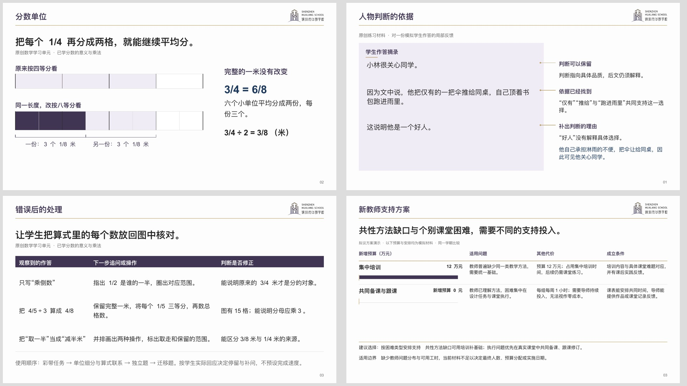

# 华朗学校汇报与教学 Skill

当前版本 **v12.1.0**。按华朗独立品牌，把实际资料整理成可编辑的校务汇报、教学材料、家长沟通和对外演示。沿用原始封面、封尾及正文品牌框架，具体内容与版面由本次读者、材料和用途决定。

## 能帮助处理什么

- **校务汇报**：把结果与比较基准放在一起，算清差额，说明证据能支持的判断，再呈现方案的费用、代价和落实条件。人数、人次、问卷份数及不同期间分别核对。
- **课堂与备课**：保留完整题目、原文和图形，把关键推理画出来、讲清理由；独立作答与答案反馈按使用场景分开，教师能找到错误后的处理办法。
- **作品与家长反馈**：展示具体作答或记录，以近邻批注定位问题，用前后对应的修改说明变化，家庭动作由仍存在的困难引出。
- **招生与公众材料**：围绕真实体验、作品、课程条件和参与方式组织。现场讲述与带走阅读分别安排，图片只能证明它实际展示的内容。

这套方法不能替代学校原始事实、教师专业判断或最终使用者的审阅。模拟案例、拟议安排和学校实绩保持清楚区别；没有实际依据的原因、成效和自动化承诺不写成结论。

## 本次怎样改进

原文批注、作品修改映射和方案取舍已经接入整稿制作工具，也可以作为局部组件组合。主材料获得足够空间，批注指向实际内容，比较保留共同尺度与不同选项的代价；超量内容按完整单元续页，避免静默丢字。数学分数条、范围标记和锚定批注可直接绘制原生对象。

从最终 PPTX 回读文案，定位数量包装、绝对承诺、制作术语上页和重复段落，再由审阅者核对重要主张与依据。自动报告明确保留人工复读状态；程序未发现问题不能证明内容或审美已经通过。

此次维护以普通任务验证能力：同一道分数题展开成完整学习单元，并用未见过的图书馆开放资料作独立校务试用。介绍稿仅作为失败样本，没有单独重做。实际范围和发现的问题见[本轮验证记录](tests/v12.1-validation.md)。

[作品反馈与支持方案](artifact-template-hualang-school/assets/v12.1-content-components.pptx?raw=true) · [学生学习单元](artifact-template-hualang-school/assets/v12.1-fraction-student.pptx?raw=true) · [教师反馈](artifact-template-hualang-school/assets/v12.1-fraction-teacher.pptx?raw=true) · [独立校务试用](artifact-template-hualang-school/assets/v12.1-library-trial.pptx?raw=true)

样例均为原创或模拟材料，仅说明本轮实际检查的用法，不能直接写成学校实绩。学习单元不宣称对应未提供的具体教材版本；静态实际渲染不代表 PowerPoint 放映、现场投影或真实课堂效果已测。

## 开始使用

下载或安装完整目录，保留模板、图片、参考文件与工具：

> 从 https://github.com/2503668375-boop/hualang-ppt-skill 安装或更新 artifact-template-hualang-school，保留旧版备份及完整资源。

附上资料，直接说明读者、用途、形式、署名和日期，例如：

> 用华朗学校汇报技能，把附件费用和实到记录整理成校务会议PPT，保留比较、差额、判断条件和可编辑对象。

教学补充教材或课程体系、学科年级、课时与已知基础；家长与招生提供作品、真实照片和当期条件。助手只追问影响结果的缺项，无需用户填写制作参数、学习脚本或组件名称。

修改时指出具体对象和目标，例如“费用页把方案放到同一尺度比较，保留人员时间成本”，或“这道题补出图形推理，学生题和答案分开”。

[下载完整仓库 ZIP](https://github.com/2503668375-boop/hualang-ppt-skill/archive/refs/heads/main.zip) · [技能入口](artifact-template-hualang-school/SKILL.md) · [上手说明](artifact-template-hualang-school/references/getting-started.md) · [版本记录](CHANGELOG.md)

## 维护与生产参考

常规任务使用[页面规格](artifact-template-hualang-school/references/deck-spec.md)与整稿构建器；需要特殊图形时使用[材料组件](artifact-template-hualang-school/references/material-components.md)和底层精修通道。Python 通道依赖 `python-pptx`、`Pillow`；原 JavaScript 通道依赖可用的原生制作运行库。

最终 PPTX 需从保存文件由实际演示引擎导出检查。结构镜像只能辅助核对坐标与对象，不能证明字体、换行或放映效果。品牌资产保持华朗独立身份；历史样张按[索引中的版本和适用范围](artifact-template-hualang-school/references/sample-index.md)使用。
