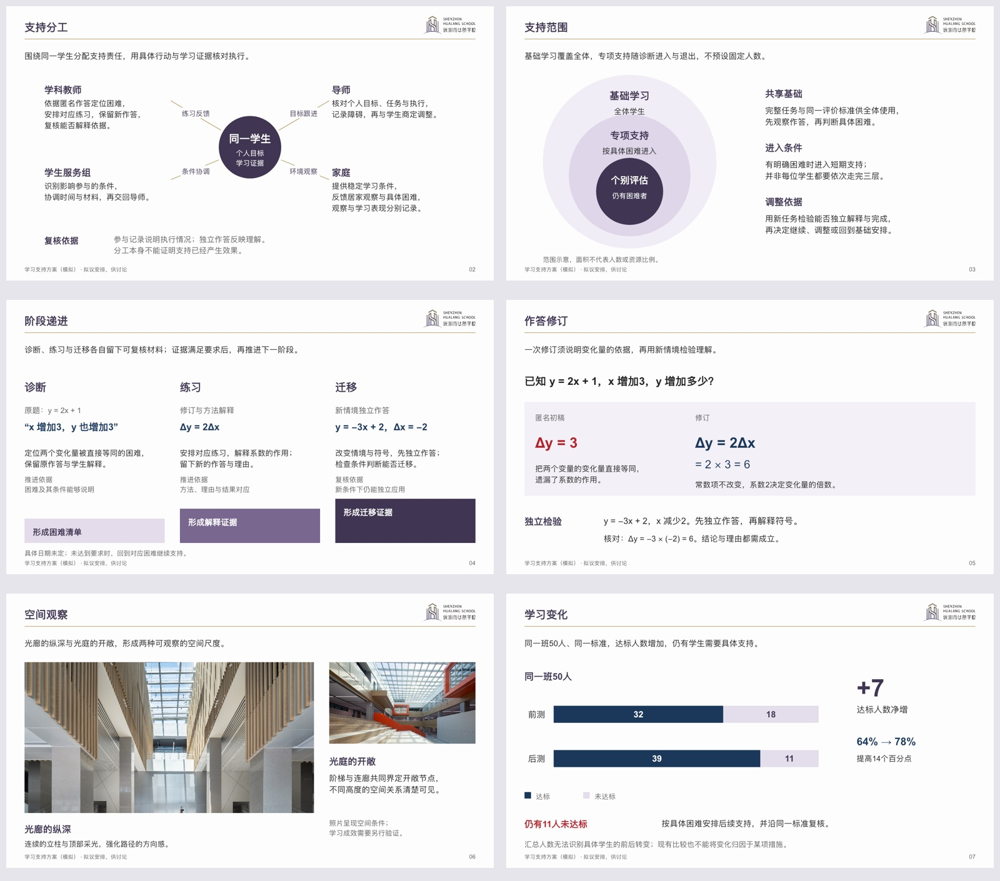

# 构图库：关系、密度与统一

起稿或调整整稿视觉时使用。先读本次场景要求，再按材料选下列关系；不逐页轮换，不要求凑齐。研究来源及本机方法的吸收边界见[排版研究](layout-research.md)。

[可编辑样张](../assets/layout-atlas.pptx)中的机制、课程安排和学习数据均为原创模拟或拟议；校园照片为既有品牌素材。六种页面只证明组合方法，不是新任务的内容底稿。固定品牌首尾仍由原资产提供。

## 先写关系句

用一句话说明“哪些具体对象，彼此是什么关系，读者需要看出什么”。例如“导师、学科教师、家庭与学生服务围绕同一学生提供不同支持”，适合中心辐射；“所有学生都有基础课程，部分学生接受短期支持”，适合包含层级。只有四条介绍时，直接按重要性编排，不凭空画中心、箭头或环。

| 内容关系 | 可用构图与局部组合 | 信息放在哪里 | 容易误导的用法 |
|---|---|---|---|
| 共同对象与真实支持 | 中心圆＋外围不等宽说明；一侧可插作品/指标 | 中心写对象，外围标题、具体动作与关系词；长说明获得更宽区域 | 六段正文塞进六个圆；外围互连却无真实关系 |
| 归属与范围 | 嵌套区域、层叠面或同心范围，配旁边的资格解释 | 标签和说明放在各自范围可见区域；关键边界就近解释 | 用面积大小冒充学生比例；独立项目硬套包含 |
| 分类与选择 | 树形分支、条件分流，终点旁写适用条件 | 分叉位置写判断条件，每条路有明确出口 | 并列课程画成必经阶段；漏掉不适用出口 |
| 多个输入共同形成结果 | 汇聚图、拼合关系或跨区共同结果 | 输入保留内容，汇合处写形成机制与输出 | 没有因果证据却以汇聚图声称效果 |
| 阶段与能力递进 | 阶梯、递进色面、逐段增量，配进入下一阶段的证据 | 阶段内写实际任务；增量与过关标准靠近对应阶段 | 纯并列分类硬排高低；台阶高低暗示未定义数值 |
| 真实反复过程 | 循环或回访路径，中心可放稳定目标 | 节点写动作，连结写触发/反馈，保留回到哪里 | 凡是四项工作都画闭环；没有反馈也加回箭头 |
| 相同口径的比较 | 共轴图、同基线对照、必要查阅表 | 直接数值、差额和解释贴近同一对象 | 环绕节点尺寸假装权重；两侧用不同尺度 |
| 前后作品或做法 | 对齐的局部样本＋错误定位＋修订理由 | 保留完整关键材料，差别发生处直接标注 | 两段概论代替实际作品；只画漂亮对比箭头 |
| 主证据与补证 | 不对称编辑式、主图＋局部放大、文字与图像叠合 | 主图承担场景，细节承担不同证据；图注在近旁 | 同义三图填满空白；叠色块遮挡人物或作品 |
| 时间与责任 | 时间×角色泳道、节点与交付物 | 同一时点共享基线，任务就近写责任/条件 | 只有阶段却伪造日期；把责任链画成时间比例 |
| 部分与整体 | 分项条形、贡献桥、必要比例图 | 同一分母、合计、增减边界直接标注 | 数据不互斥仍画饼图；装饰环暗示达成率 |
| 少量核心结论 | 大数字或主句＋对应证据与条件 | 数字带单位、期间和解释；剩余空间交给有用内容 | 只有口号占整页；套成每页固定大字版 |

## 中心辐射怎样放得下内容

先给中心确定焦点，再根据外围材料长度分配位置。中心无须严格在画布正中；外围不必等角、等面积、等字数。具体对象可以由标题＋正文、照片局部、作品、一个指标或短条件组成；同一层关系保留相同字体角色。

读者应能沿“中心对象—关系—具体支持”读完一组。例如“同一学生—学科支持—依据匿名作答安排下一次练习”。说明较长时，用开放文本区围绕中心，关系词贴近连接，或将主图缩至一侧并给另一侧完整说明。不要为了漂亮圆阵删去依据与条件。照片与指标只在能说明该关系时加入。

仅有中心到外围的关系时，不画外围闭环。距离与朝向已足以分组时可以省连接线；需要方向时让实际动作词说明方向，必要时再加箭头。无数值含义的圆、台阶和嵌套面积不代表权重或人数，涉及误读时明确“关系/范围示意，非比例”。

`hubSpoke`提供可编辑中心与外围区域，具体示例见[制作API](production-api.md#中心辐射)。`starOrbit`继续兼容旧稿，只适合短标签环绕；长解释用新入口或直接按原生对象安排，不能把短标签环绕当成所有关系图的默认。

## 一页怎样组合

选择一个主要关系，再配必要局部。例如中心辐射配一段证据和边界，阶梯配每级的任务与评价，作品对照配近邻批注，照片配一块主张与两个细节。局部组件服从主对象的阅读路径，不各自形成一套标题、底框和结束语。

同页采用不同组件时，让字号职责、文字起线、组内间距和色彩含义一致；按真实负载分配面积。紫色圆、局部浅紫面、原生图、开放文本可以共存。矩形可承担作品区域、强调或查阅分组；线条可承担坐标、关系、定位和必要分隔。每一种形状都要有作用，避免整稿固定用一种。

## 密度与主题一起检查

- **阅读型页面**：该页问题所需的材料、解释与成立条件足够；关系图只有少量节点时，不放大到挤掉分析。先调主次、合并复述和分配区域，仍容纳不了时按真实问题续页。
- **课堂页面**：题干、图形、推理与反馈按使用单元完整，末态能对照；不因选择辐射/阶梯而删题目、答案或必要理由。
- **现场讲述页面**：主对象与短句能被辨认，完整讲述单元由相邻证据承接；不能拿一张简洁示意替代整份内容。
- **品牌固定项**：原首尾及常规正文的左题右徽、金线与近白底；远距实景主视觉按[出血规则](scene-visual-grammar.md#整页出血对外专用)使用例外。黑色正文、紫色层级、深蓝分析、红色重点的职责稳定，主体轮廓与颜色面积随内容变化。
- **两种尺度**：缩略图看焦点、重心、视觉质量和相邻关系；实际尺寸看正文、关系词、条件和细节。框换成线、圆换成框、左右镜像都可能保留同一骨架。

若相邻独立议题持续出现“横线＋多行说明”“中心圆＋外围标签”或“等分面板”，回到各页材料判断是否值得换主体。必要同题推理、同字段比较保持稳定。未有本次明确要求时，不以每页不同、固定组件数、留白率或版型数量验收；用户指定的上限按[相邻页审查](composition.md#整稿与实页复核)逐页清点，存在实质冲突时不静默豁免。

## 换给其他 AI 试用

使用[独立试用任务](other-ai-trial.md)，提供完整技能目录与原始材料即可。先让执行者独立判断版式，不把本样张或预计页序当作答案。比较实际PPT及其预览、原生对象、内容覆盖和密度，不能从“已调用技能”推定设计有效。
